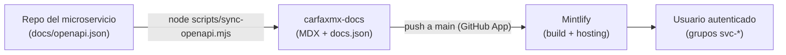

# carfaxmx-docs

> Sitio de documentación interna de los microservicios de CARFAX MX, construido con Mintlify, para equipos internos y consumidores autorizados de los servicios.

  

## Tabla de contenidos

Menor a 200 líneas; se omite por estándar.

## Overview

Este repositorio contiene el sitio de documentación de los microservicios de CARFAX MX. Cada servicio se publica con páginas conceptuales en español e inglés y una referencia de API generada desde su spec OpenAPI. El acceso al sitio es privado y, con el plan Enterprise de Mintlify, granular por usuario mediante grupos (`svc-<servicio>`).

**No resuelve**: la generación de los specs OpenAPI (vive en cada repo de microservicio con `npm run docs:export`) ni la autenticación de los servicios documentados.

**Consumidores**: equipos internos de CARFAX MX y, por invitación, consumidores externos autorizados de servicios específicos.

## Metadata

| Campo | Valor |
| --- | --- |
| Tier | 3 (documentación; no está en ruta de ejecución) |
| Equipo propietario | `@carfax-mx/<equipo-plataforma>` |
| On-call | No aplica (sitio estático gestionado por Mintlify) |
| Entornos | Producción: `<DOCS_HOST>` (Mintlify); preview local con `mint dev` |
| Runbook | `es/guias/control-de-acceso.mdx` (alta de usuarios y grupos) |
| Dashboards | Dashboard de Mintlify (`https://dashboard.mintlify.com`) |
| Clasificación de datos | Interna — sin PII; placeholders y datos sintéticos únicamente |

## Arquitectura y stack



- Mintlify (tema `mint`, `docs.json` como configuración).
- MDX para contenido; OpenAPI 3.1 para referencia de API.
- Node.js (script de sincronización, sin dependencias externas).

## Prerrequisitos

- Node.js >= 20 (para `npx mint` y `scripts/sync-openapi.mjs`).
- Los repos de los microservicios clonados como hermanos de este directorio (el sync usa rutas relativas `../CARFAXMX-<servicio>`).

## Instalación

1. Clonar el repo y entrar al directorio.
2. No hay dependencias que instalar; el CLI se usa vía `npx mint@latest`.

## Configuración / Variables de entorno

No aplica: el sitio no consume variables de entorno. La configuración vive en `docs.json` y el acceso se gestiona en el dashboard de Mintlify.

## Uso / Quick start

```bash
npx mint@latest dev --no-open   # preview en http://localhost:3000
```

Para simular un usuario con grupos (visibilidad granular):

```bash
npx mint@latest dev --groups svc-ms-consulta-ws --no-open
```

## Scripts / Comandos

| Comando | Descripción |
| --- | --- |
| `node scripts/sync-openapi.mjs` | Trae el `openapi.json` de cada microservicio e inyecta `x-mint.groups` |
| `npx mint@latest dev` | Preview local |
| `npx mint@latest validate` | Valida `docs.json`, páginas y specs OpenAPI |
| `npx mint@latest broken-links` | Revisa links rotos |

## Estructura del proyecto

```
docs.json                  # Configuración del sitio (idiomas, tabs, API)
es/                        # Contenido en español (fuente de verdad)
en/                        # Espejo en inglés
api-reference/<servicio>/  # Specs OpenAPI sincronizados (generados, no editar)
scripts/                   # sync-openapi.mjs
logo/, favicon.svg         # Branding
```

## Testing

No hay suite de pruebas (repo de contenido). El gate equivalente es `npx mint@latest validate` + `npx mint@latest broken-links` antes de cada PR.

## Despliegue

Push a `main` → la GitHub App de Mintlify construye y publica automáticamente. Rollback: revertir el commit y volver a hacer push. No hay pipeline propio.

## Observabilidad

Analytics y feedback de páginas en el dashboard de Mintlify (`mint analytics`). No aplica SLI/SLO propio: la disponibilidad es de Mintlify.

## Seguridad

- Acceso: sitio **privado** (Dashboard → Access → Visibility Private). Fase 2 con Enterprise: JWT con grupos por usuario. Detalle en `es/guias/control-de-acceso.mdx`.
- Contenido: prohibido incluir secretos, hosts internos, PII o datos reales de clientes; solo placeholders y datos sintéticos (ver `AGENTS.md`, sección Content boundaries).
- Dependencias: ninguna en runtime; el CLI se consume vía `npx` siempre en su última versión.

## Contribución

1. Rama desde `main` (`docs/<tema>`), Conventional Commits.
2. Todo cambio de contenido actualiza `es/` y `en/` en el mismo PR.
3. Nunca editar `api-reference/*/openapi.json` a mano; correr el sync.
4. PR requiere `mint validate` y `mint broken-links` limpios.

## Versionado y changelog

El contenido no se versiona con SemVer: la historia de git y los deploys de Mintlify son el registro. Los specs heredan la versión de cada microservicio.

## Licencia

UNLICENSED — propiedad de CARFAX MX; uso interno.

## Equipo y contacto

- Equipo: `@carfax-mx/<equipo-plataforma>`
- Canal: `#<canal-docs>` (Teams)

## Referencias

- [Mintlify docs](https://mintlify.com/docs) — plataforma.
- ADRs de cada servicio: `docs/adr/` en el repo del microservicio correspondiente.
