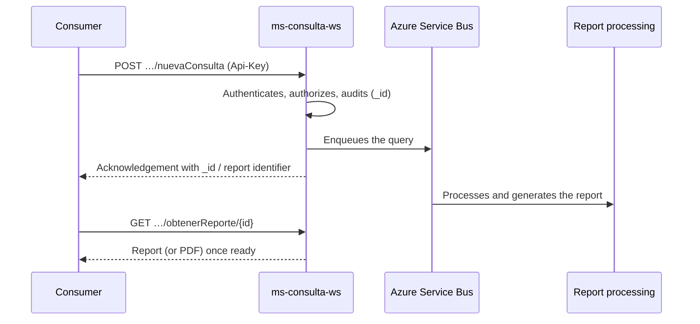

`ms-consulta-ws` is the entry point for CARFAX MX vehicle history queries. It receives requests by **VIN** or **plate**, records them in the audit trail, enqueues them on Azure Service Bus, and later delivers the generated report or its PDF.

| Fact | Value |
| --- | --- |
| Tier | **1** — business-critical path |
| Stack | NestJS 11 · Fastify 5 · Node 24 |
| Authentication | `Api-Key` header (every route except `/health`) |
| Data classification | Confidential — handles PII |

## Who consumes it

- **State entities**: Estado de México (and SSEDOMEX), Guanajuato, Nuevo León, Baja California, Baja California Sur, Querétaro, Coahuila, Quintana Roo, and CDMX.
- **Institutions**: REPUVE, ANAM (SIADECON), ANAPROMEX, CAS, and internal CARFAX consumers.
- **Dealers**: distributors identified by slug under `/api/dealers/{dealer}`, with their own contract and a reduced report view.

Each consumer works with two basic operations: `POST …/nuevaConsulta` to start a query and `GET …/obtenerReporte/{id}` to retrieve the result (in some cases also as a PDF).

## Query flow

Processing is **asynchronous**: `nuevaConsulta` responds immediately with the identifier and the report is retrieved later with `obtenerReporte`. If the report isn't ready yet, the response says so (for example `ready: false` in the legacy contract).

## What this service does NOT do

- It doesn't generate or interpret the report: that happens in downstream processing services.
- It doesn't render PDFs: it requests them from the internal PDF service.
- It doesn't manage Api-Keys: credentials are managed outside this service.

## Next steps

<CardGroup cols={2}>
  <Card title="Getting started" icon="rocket" href="/en/services/ms-consulta-ws/getting-started">
    From zero to your first query with an `Api-Key`.
  </Card>
  <Card title="API reference" icon="code">
    All 46 endpoints with schemas, examples, and a playground, under the **API reference** group in the sidebar.
  </Card>
</CardGroup>
