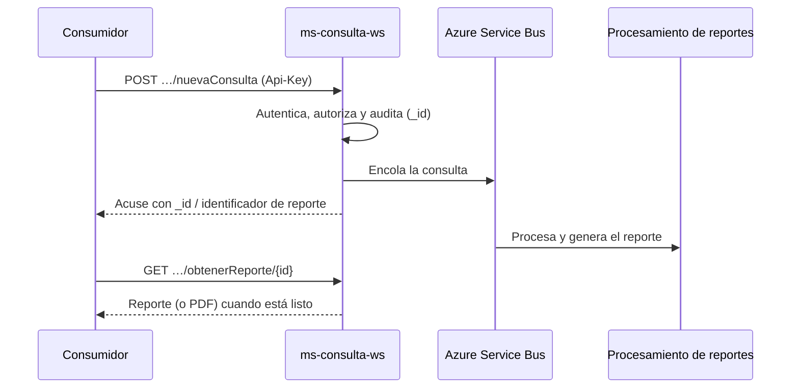

`ms-consulta-ws` es la puerta de entrada de las consultas de historial vehicular de CARFAX MX. Recibe solicitudes por **VIN** o **placa**, las registra en auditoría, las encola en Azure Service Bus y después entrega el reporte generado o su PDF.

| Dato | Valor |
| --- | --- |
| Tier | **1** — ruta crítica de negocio |
| Stack | NestJS 11 · Fastify 5 · Node 24 |
| Autenticación | Header `Api-Key` (todas las rutas excepto `/health`) |
| Clasificación de datos | Confidencial — maneja PII |

## Quién lo consume

- **Entidades** estatales: Estado de México (y SSEDOMEX), Guanajuato, Nuevo León, Baja California, Baja California Sur, Querétaro, Coahuila, Quintana Roo y CDMX.
- **Instituciones**: REPUVE, ANAM (SIADECON), ANAPROMEX, CAS y consumidores internos de CARFAX.
- **Dealers**: distribuidores identificados por slug bajo `/api/dealers/{dealer}`, con contrato propio y vista reducida del reporte.

Cada consumidor opera con dos operaciones básicas: `POST …/nuevaConsulta` para iniciar una consulta y `GET …/obtenerReporte/{id}` para recuperar el resultado (en algunos casos también en PDF).

## Flujo de una consulta

El procesamiento es **asíncrono**: `nuevaConsulta` responde de inmediato con el identificador y el reporte se recupera después con `obtenerReporte`. Si el reporte aún no está listo, la respuesta lo indica (por ejemplo `ready: false` en el contrato legado).

## Qué NO hace este servicio

- No genera el reporte ni lo interpreta: eso ocurre en los servicios de procesamiento aguas abajo.
- No genera los PDF: los solicita al servicio de PDF interno.
- No administra las Api-Keys: las credenciales se gestionan fuera de este servicio.

## Siguientes pasos

<CardGroup cols={2}>
  <Card title="Primeros pasos" icon="rocket" href="/es/servicios/ms-consulta-ws/primeros-pasos">
    De cero a tu primera consulta con `Api-Key`.
  </Card>
  <Card title="Referencia de API" icon="code">
    Los 46 endpoints con esquemas, ejemplos y playground, en el grupo **Referencia de API** de la barra lateral.
  </Card>
</CardGroup>
